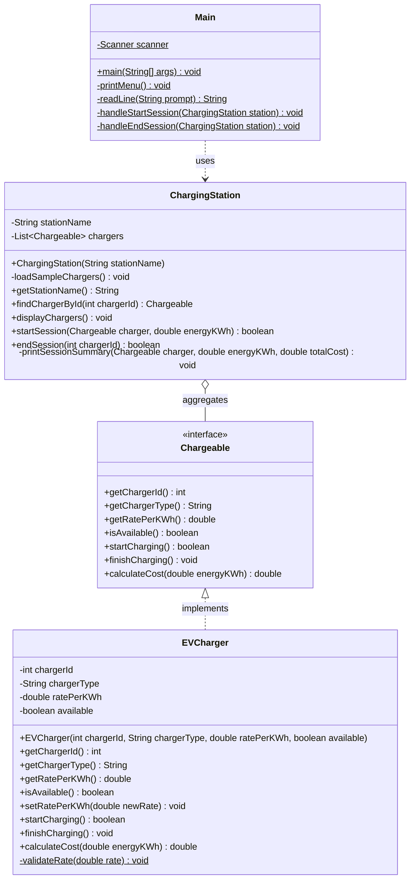
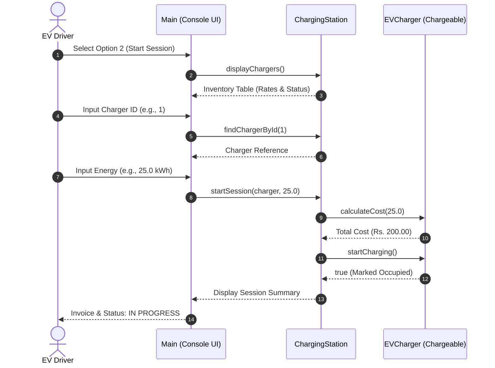
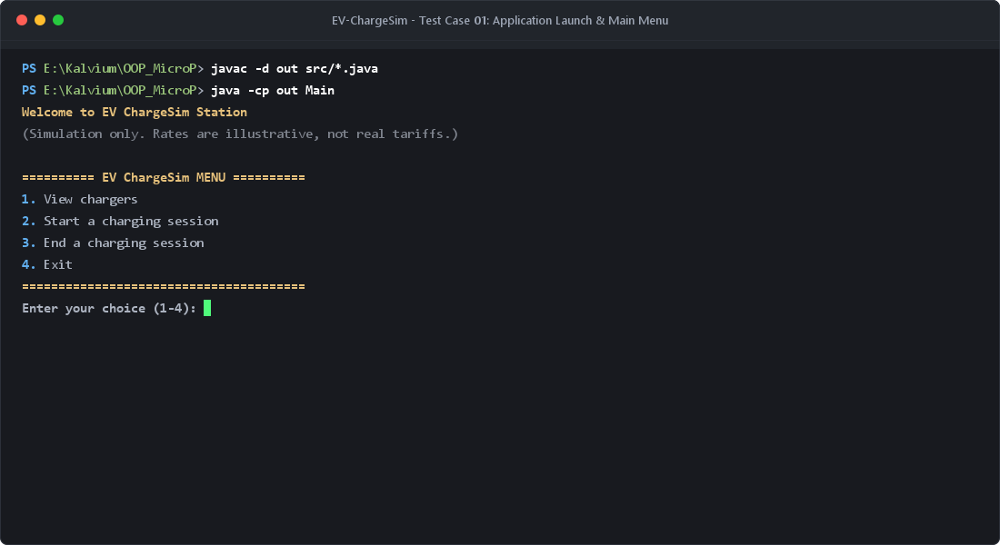
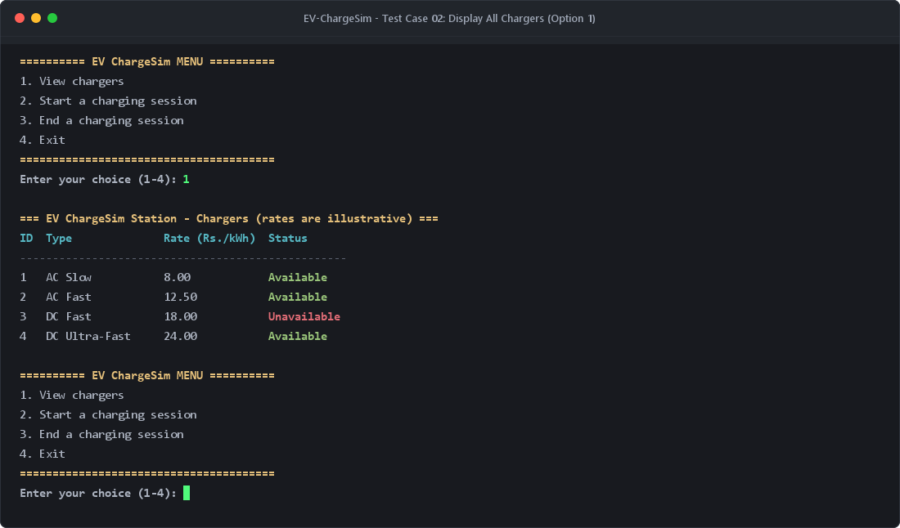
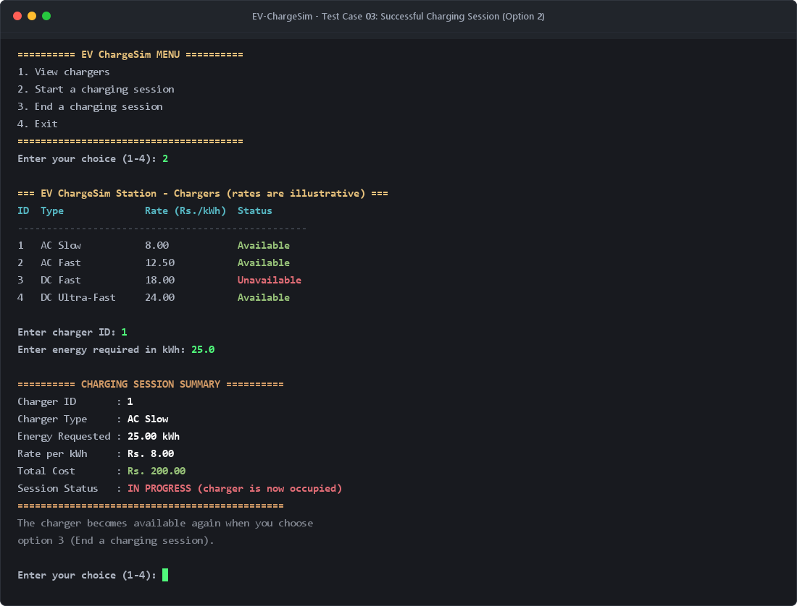
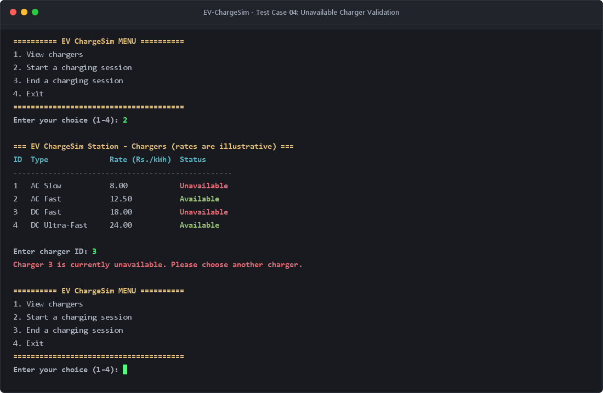
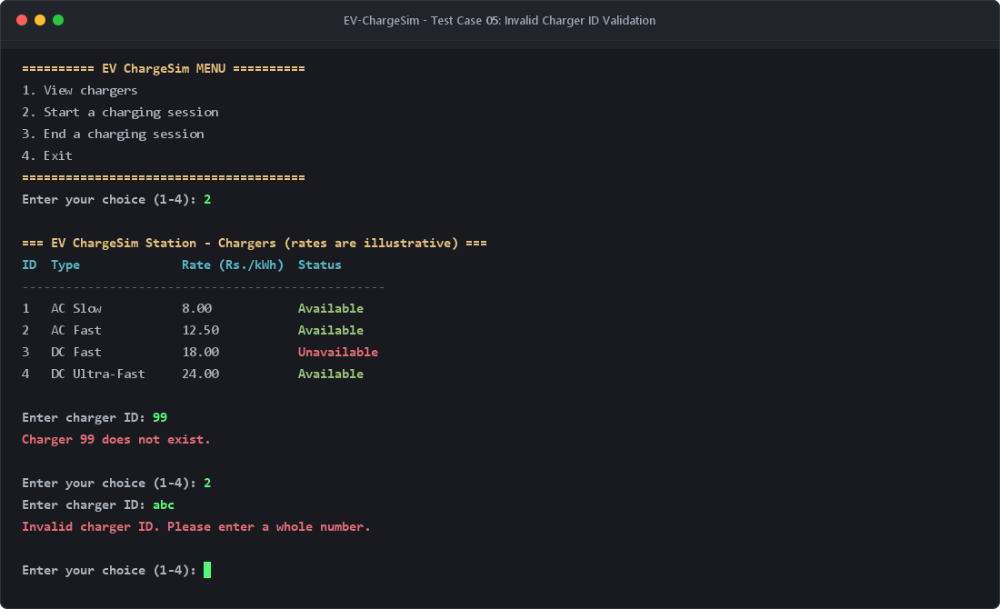
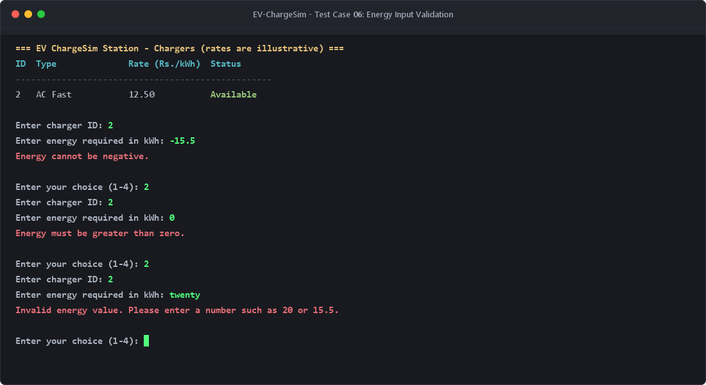
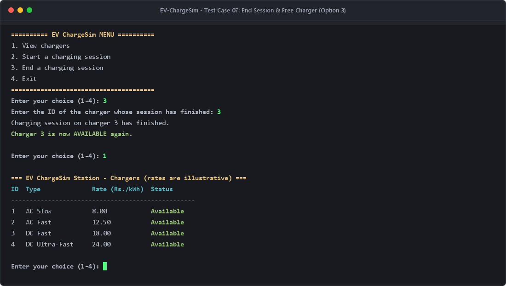
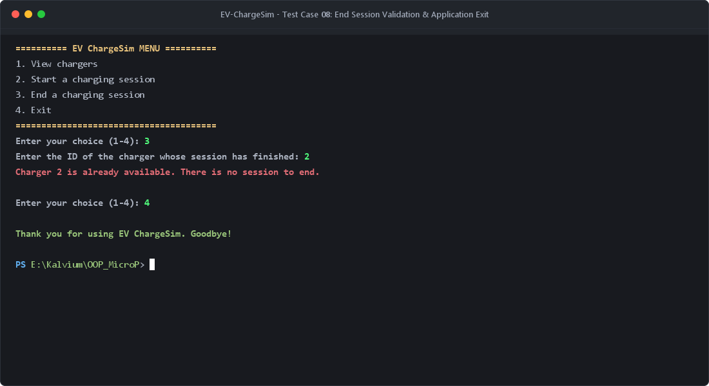

# ⚡ EV-ChargeSim — Electric Vehicle Charging Station Simulator

[](https://www.oracle.com/java/)
[](#-object-oriented-programming-oop-principles)
[](#-how-to-run)
[](LICENSE)

An interactive, robust, and extensible **Electric Vehicle (EV) Charging Station Simulation System** implemented in pure Java. EV-ChargeSim models a smart charging depot supporting diverse charger specifications (AC Slow, AC Fast, DC Fast, and DC Ultra-Fast), real-time occupancy state transitions, dynamic tariff cost computations, and defensive input validation.

Developed as an **Object-Oriented Programming (OOP) Micro Project** demonstrating core software engineering principles such as **Abstraction**, **Encapsulation**, **Polymorphism**, and **Separation of Concerns**.

---

## 📋 Table of Contents

- [Overview](#-overview)
- [Key Features](#-key-features)
- [Object-Oriented Programming (OOP) Principles](#-object-oriented-programming-oop-principles)
- [Architecture & Class Diagram](#-architecture--class-diagram)
- [System Workflow](#-system-workflow)
- [Project Structure](#-project-structure)
- [How to Run](#-how-to-run)
- [Testing & Visual Walkthrough (8 Test Cases)](#-testing--visual-walkthrough-8-test-cases)
- [Sample Charger Configurations](#-sample-charger-configurations)
- [Author & Academic Attribution](#-author--academic-attribution)

---

## 🌟 Overview

As electric mobility surges globally, charging infrastructure management systems must reliably arbitrate access, track station occupancy, prevent concurrent charging conflicts, and compute tariffs accurately based on requested energy volumes.

**EV-ChargeSim** simulates this ecosystem through an interactive terminal interface backed by a clean object-oriented architecture. Users can:
1. Inspect available station bays and their real-time operational status.
2. Select an eligible charger and specify battery energy demand (in kWh).
3. Secure immediate cost breakdowns based on unit rates and start the charging session.
4. Conclude active charging sessions to return bays back to the available pool.

---

## 🚀 Key Features

- **⚡ Multi-Tier Charger Specifications**: Supports AC Slow, AC Fast, DC Fast, and DC Ultra-Fast charging units with customizable hourly/kWh tariffs.
- **🔄 Real-Time State Lifecycle**: Seamless bay occupancy toggling (`Available` ↔ `Occupied / In Progress`).
- **💰 Dynamic Cost Calculation Engine**: Automated computation of session fees ($Total = \text{Energy (kWh)} \times \text{Rate per kWh}$) with defensive numeric checks.
- **🛡️ Defensive Input Validation**: Comprehensive protection against non-existent charger IDs, string inputs, non-numeric values, negative energy, and zero energy requests.
- **🚫 Concurrency & State Guard**: Prevents double-booking already occupied chargers and prevents ending sessions on idle units.
- **📊 Clean Interactive Console UI**: Intuitive tabular reports, session invoices, and user feedback prompts.

---

## 🧩 Object-Oriented Programming (OOP) Principles

The design of EV-ChargeSim prioritizes maintainability, loose coupling, and high cohesion:

### 1. Abstraction (`Chargeable.java`)
- The `Chargeable` interface defines **what** a charger can do without exposing **how** it operates internally.
- Contracts for querying ID, type, rate, availability, initiating sessions, ending sessions, and calculating costs are decoupled from underlying hardware or software implementations.

### 2. Encapsulation (`EVCharger.java`)
- Internal state fields (`chargerId`, `chargerType`, `ratePerKWh`, `available`) are strictly `private`.
- Read access is mediated via public getters (`getChargerId()`, `isAvailable()`, etc.).
- State updates are controlled through validated domain methods (`startCharging()`, `finishCharging()`, `setRatePerKWh()`), preventing inconsistent external mutations (e.g., negative rates or illegal occupancy states).

### 3. Polymorphism & Interface Segregation (`ChargingStation.java`)
- `ChargingStation` maintains a collection of `List<Chargeable>`, working directly with the abstraction rather than concrete subclasses.
- Any future charger type (e.g., `WirelessInductiveCharger`, `SolarAssistedCharger`) can be introduced seamlessly by implementing `Chargeable` without modifying `ChargingStation`.

### 4. Separation of Concerns & Clean Layering
- **Presentation Layer (`Main.java`)**: Manages console I/O, user prompts, input sanitization, and menu routing.
- **Orchestration Layer (`ChargingStation.java`)**: Governs station-level operations, charger discovery, inventory display, and session coordination.
- **Domain Layer (`EVCharger.java`, `Chargeable.java`)**: Enforces charger-level business rules, rate validation, and billing algorithms.

---

## 🏛️ Architecture & Class Diagram



---

## 🔄 System Workflow



---

## 📁 Project Structure

```text
EV-ChargeSim/
├── src/
│   ├── Chargeable.java          # Abstract interface defining charger contracts
│   ├── EVCharger.java           # Concrete implementation with full encapsulation
│   ├── ChargingStation.java     # Station controller managing fleet & sessions
│   └── Main.java                # Console application entrypoint & input handler
├── screenshots/
│   ├── 01_main_menu.png                        # Test Case 1: Startup & Menu
│   ├── 02_view_chargers.png                    # Test Case 2: Inventory Display
│   ├── 03_start_charging_success.png           # Test Case 3: Session Start & Invoice
│   ├── 04_start_charging_unavailable.png       # Test Case 4: Occupancy Validation
│   ├── 05_invalid_charger_id.png               # Test Case 5: ID Validation
│   ├── 06_invalid_energy_input.png             # Test Case 6: Energy Validation
│   ├── 07_end_charging_session.png             # Test Case 7: Session Release
│   └── 08_end_session_validation_and_exit.png  # Test Case 8: Idle Unit & Exit
├── report/
│   └── .gitkeep                 # Project documentation / report directory
├── .gitignore                   # Ignores compiled bytecode and IDE settings
└── README.md                    # Comprehensive documentation & visual guide
```

---

## 💻 How to Run

### Prerequisites
- **Java Development Kit (JDK)**: Version 8 or higher (JDK 17, 21, or 24 recommended).
- **Git** (for version control).

### 1. Clone the Repository
```bash
git clone https://github.com/CooCooCoder/EV-ChargeSim.git
cd EV-ChargeSim
```

### 2. Compile the Source Code
Compile all `.java` files from `src/` into the `out/` build directory:
```bash
# Windows (PowerShell / Command Prompt)
javac -d out src/*.java

# Linux / macOS
javac -d out src/*.java
```

### 3. Run the Application
Launch the compiled bytecode:
```bash
java -cp out Main
```

---

## 🧪 Testing & Visual Walkthrough (8 Test Cases)

The application has been tested across 8 distinct operational scenarios, verifying both standard workflows and edge-case error conditions. High-resolution captures of these test runs are saved in the `screenshots/` directory:

---

### Test Case 1: Application Launch & Main Menu
- **Objective**: Verify startup banner, illustrative tariff disclaimer, and main menu rendering.
- **Verification**: Clean welcome prompt showing options `1. View chargers`, `2. Start a charging session`, `3. End a charging session`, and `4. Exit`.



---

### Test Case 2: Display All Chargers (Option 1)
- **Objective**: Ensure all registered station chargers are listed in formatted tabular layout with IDs, types, illustrative rates (Rs./kWh), and availability flags.
- **Verification**: Charger 1 (AC Slow), Charger 2 (AC Fast), Charger 3 (DC Fast - Occupied), and Charger 4 (DC Ultra-Fast).



---

### Test Case 3: Successful Charging Session (Option 2)
- **Objective**: Initiate an active charging session on an available unit (Charger ID 1) with requested energy (25.0 kWh).
- **Verification**: Accurate tariff calculation ($25.00 \text{ kWh} \times \text{Rs. } 8.00 = \text{Rs. } 200.00$), summary invoice generation, and status transition to `IN PROGRESS (occupied)`.



---

### Test Case 4: Occupied / Unavailable Charger Validation (Option 2)
- **Objective**: Verify that occupied bays cannot be double-booked.
- **Verification**: Selecting Charger ID 3 (currently `Unavailable`) triggers defensive guard: `Charger 3 is currently unavailable. Please choose another charger.` without state corruption.



---

### Test Case 5: Invalid Charger ID Validation
- **Objective**: Test system resilience against non-existent and non-numeric charger IDs.
- **Verification**: Entering `99` prompts `Charger 99 does not exist.`; entering `abc` prompts `Invalid charger ID. Please enter a whole number.`.



---

### Test Case 6: Energy Input Validation
- **Objective**: Verify input boundaries for requested energy amounts (negative, zero, non-numeric).
- **Verification**: Entering `-15.5` triggers `Energy cannot be negative.`; entering `0` triggers `Energy must be greater than zero.`; entering `twenty` triggers `Invalid energy value. Please enter a number such as 20 or 15.5.`.



---

### Test Case 7: End Session & Free Charger (Option 3)
- **Objective**: Conclude a charging session and release the occupied charger back to the available pool.
- **Verification**: Ending session on Charger ID 3 releases it with `Charger 3 is now AVAILABLE again.`. Re-checking with Option 1 confirms all chargers are available.



---

### Test Case 8: Idle Charger Validation & Application Exit (Options 3 & 4)
- **Objective**: Verify validation when attempting to terminate a session on an already idle charger, followed by a graceful application exit.
- **Verification**: Terminating Charger ID 2 yields `Charger 2 is already available. There is no session to end.`. Choosing Option 4 gracefully closes the scanner and prints the exit greeting.



---

## ⚡ Sample Charger Configurations

The station comes pre-configured with four representative charging tiers:

| ID | Charger Type | Rate (Rs./kWh) | Initial Status | Typical Application |
|:--:|:-------------|:--------------:|:--------------:|:--------------------|
| **1** | AC Slow | ₹ 8.00 | `Available` | Long-dwell overnight / workplace charging |
| **2** | AC Fast | ₹ 12.50 | `Available` | Commercial destination charging (malls, hotels) |
| **3** | DC Fast | ₹ 18.00 | `Unavailable` | Rapid en-route charging (highways, fleet depots) |
| **4** | DC Ultra-Fast | ₹ 24.00 | `Available` | High-throughput ultra-rapid transit hubs |

*Note: Rates are illustrative values modeled for educational simulation purposes.*

---

## 🔮 Future Enhancements

- [ ] **Vehicle Profile Modeling**: Associate vehicle battery capacity (e.g., 40 kWh, 75 kWh) and State of Charge (SoC).
- [ ] **Time-of-Use (ToU) Dynamic Tariffs**: Peak and off-peak electricity pricing multipliers.
- [ ] **Persistent Storage**: Save session histories and financial logs to SQLite or JSON data stores.
- [ ] **Graphical User Interface (GUI)**: Desktop dashboard using JavaFX / Swing or Web interface.

---

## 👨‍💻 Author & Academic Attribution

- **Developer**: CooCooCoder ([@CooCooCoder](https://github.com/CooCooCoder))
- **Course**: Object-Oriented Programming (OOP) Micro Project
- **Institution**: Kalvium
- **Repository**: [https://github.com/CooCooCoder/EV-ChargeSim.git](https://github.com/CooCooCoder/EV-ChargeSim.git)

---

*Made with ☕ and Java.*
